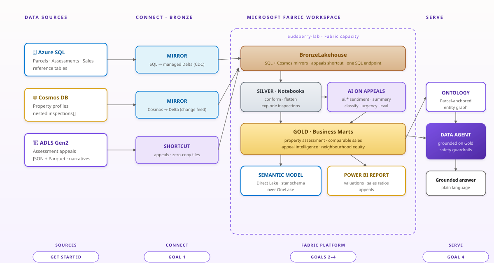

# Sudsberry Property Assessment Data Lab

A hands-on Microsoft Fabric workshop that builds an end-to-end property assessment
analytics and AI solution for the fictional municipality of **Sudsberry** — from three
operational sources through a Bronze → Silver → Gold medallion to a Direct Lake report,
a Fabric ontology, and an ontology-grounded data agent.

**What attendees build:** three operational sources (Azure SQL, Cosmos DB, ADLS Gen2) mirrored
into OneLake, a Bronze → Silver → Gold medallion in Spark notebooks, AI enrichment of appeal
narratives with Fabric AI functions (evaluated against ground truth), a Direct Lake semantic model
and report, a Fabric ontology, and a data agent grounded on that ontology.



## Modules

| # | Module | What you do |
|---|---|---|
| 0 | Setup | Sign in with your lab account and check workspace access |
| 1 | Workspace tour | Walk the pre-provisioned workspace and the target architecture |
| 2 | Bronze ingestion | Mirror Azure SQL and Cosmos DB, shortcut ADLS appeals |
| 3 | Silver transform | Conform dimensions and facts, flatten profiles, explode inspections |
| 4 | AI insights | Classify appeal narratives with Fabric AI functions (or Azure AI Foundry) and evaluate against ground truth |
| 5 | Gold marts | Build four business marts |
| 6 | Direct Lake | Semantic model and Power BI report |
| 7 | Ontologies | Define and bind Property, Neighborhood, ComparableSale and Appeal entities over the Gold marts |
| 8 | Data agents | Ground a Fabric Data Agent on the ontology and ask questions in plain English |

Notebooks for each step are in [`assets/notebooks/`](assets/notebooks/).

## Prerequisites

- A Microsoft Fabric capacity (trial or F-SKU) and a workspace you can create items in
- Azure SQL Database, Azure Cosmos DB and an ADLS Gen2 account with the synthetic source data
  (see the [attendee repository](https://github.com/nickTinMicrosoft/fabric-hackathon-attendee-accessor))
- Fabric AI functions enabled for Module 4; an Azure AI Foundry project for the optional 4a variant

## View the site

Once GitHub Pages is enabled for this repo, the lab is served at:

**https://amruthasatishkumar.github.io/fabric-hackathon-lab/**

## Run locally

It's a static site — open `index.html` in a browser, or serve the folder:

```bash
python -m http.server 8080
# then open http://localhost:8080
```

## Structure

- `index.html` — lab overview / use case and module grid
- `module-0-setup.html` … `module-8-data-agents.html` — the goal modules
- `closing.html`, `appendix-learn-links.html` — wrap-up and references
- `assets/` — CSS, JS (sidebar nav + code copy/download), images

## Goals

1. **Bronze** — mirror Azure SQL & Cosmos DB and shortcut ADLS Gen2 into a Bronze Lakehouse
2. **Silver** — conform dimensions/facts, flatten profiles, ingest appeals
3. **AI** — enrich appeal narratives with Fabric AI functions and evaluate against ground truth
4. **Gold** — business marts, a Direct Lake semantic model + report, a Fabric ontology, and a data agent

Lab content is aligned to the
[Fabric Property Assessment Hackathon repository](https://github.com/nickTinMicrosoft/fabric-hackathon-attendee-accessor).
All data is synthetic.

## Licence

[MIT](LICENSE). Microsoft Fabric and other product names are trademarks of their owners; this is a
community workshop, not an official Microsoft offering.
